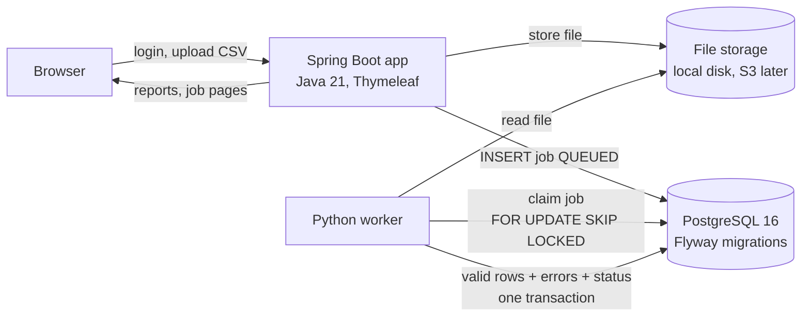
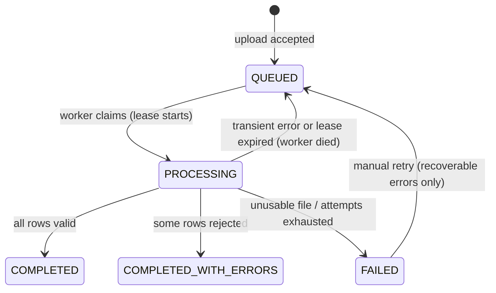

# PulseOps

**Build reports. Monitor integrations. Diagnose failures.**

PulseOps is a multi-tenant B2B platform that receives customer sales datasets, validates and
processes them asynchronously, generates reports, and gives support engineers the evidence they
need to investigate failures. All data in this repository is synthetic.

> **Status:** work in progress. Phases 0–1 complete, Phase 2 (reliability) mostly complete.
> See [Implementation status](#implementation-status) for exactly what is built and tested.

## Architecture



| Component | Responsibility |
|---|---|
| `backend/` Spring Boot 4 (Java 21) | Authentication, tenant isolation, uploads, job pages, reports, retries, audit trail |
| `worker/` Python 3.11 | Claims queued jobs, validates CSV rows, stores results, recovers abandoned jobs |
| PostgreSQL 16 | Data, job queue, audit log. Schema owned by Flyway migrations |

### Job lifecycle



## Key engineering decisions

- **PostgreSQL as the job queue.** Workers claim jobs with `UPDATE … WHERE id = (SELECT … FOR UPDATE SKIP LOCKED LIMIT 1)`, so several workers can run in parallel without ever taking the same job. No extra infrastructure; can be swapped for AWS SQS later.
- **Crash safety.** All writes for a job happen in one transaction. A claimed job carries a lease; if a worker dies, the lease expires and the job is re-queued. The final status update is fenced (`WHERE worker_id = me`), so a late, stale worker cannot overwrite results.
- **No duplicate data.** `UNIQUE (tenant_id, transaction_id)` plus `ON CONFLICT DO NOTHING RETURNING` reports already-processed rows instead of storing them twice.
- **Tenant isolation.** Every query filters on `tenant_id` taken from the authenticated session, never from the request. Other tenants' records return 404.
- **Permanent vs transient errors.** Data errors (missing columns, bad encoding) fail fast and are not retried; infrastructure errors are retried with back-off and can be retried manually.
- **Exact money.** `NUMERIC(12,2)` in the database and `Decimal` in Python; no floating point.
- **Traceability.** Every HTTP request gets a correlation ID (`X-Correlation-Id`), reused as the job's ID in worker logs. Logs are written as JSON for searching.

## Run it locally

Prerequisites: Java 21, Docker, Python 3.11+.

```bash
cp .env.example .env              # then set real values
docker compose up -d              # PostgreSQL

# terminal 1: web app (http://localhost:8080)
cd backend && set -a && source ../.env && set +a && ./mvnw spring-boot:run

# terminal 2: worker
cd worker && python -m venv .venv && source .venv/bin/activate
pip install -r requirements.txt
set -a && source ../.env && set +a && python -m pulseops_worker.main
```

With `SPRING_PROFILES_ACTIVE=dev`, two fictional tenants are created (Meridian Health Group,
Harbourline Retail) with users `meridian.admin`, `meridian.analyst`, `meridian.support`,
`harbour.admin`, `harbour.analyst`. Their password is the `PULSEOPS_DEMO_PASSWORD` you set.

Try the files in `sample-data/`: a valid file, a file with row errors, and a file with a missing column.

## Tests

```bash
cd backend && ./mvnw test                         # Java: HTTP security + tenant isolation tests
cd worker && python -m pytest                     # Python unit tests
PULSEOPS_TEST_DSN="host=localhost port=5432 dbname=pulseops user=pulseops password=…" \
  python -m pytest                                # + tests against real PostgreSQL
```

## Implementation status

| Area | Status |
|---|---|
| Login (BCrypt), roles, tenant isolation, CSRF | ✅ Built and tested |
| CSV upload, job queue, Python worker, validation | ✅ Built and tested |
| Reports + CSV download (formula-injection safe) | ✅ Built and tested |
| Retries with back-off, lease recovery, manual retry, audit trail | ✅ Built and tested |
| Correlation IDs, JSON logs | ✅ Built |
| REST API with API keys, OpenAPI, Postman collection | ⬜ Planned |
| Incident Centre, Failure Simulation Lab | ⬜ Planned |
| CI pipeline, Testcontainers, Docker image for the app | ⬜ Planned |
| AWS deployment design (S3, RDS, CloudWatch) | ⬜ Planned |
